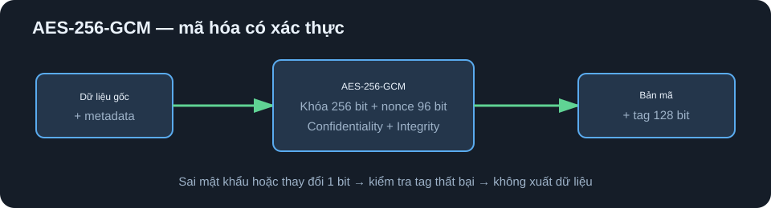
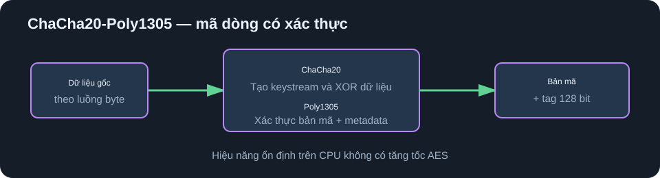
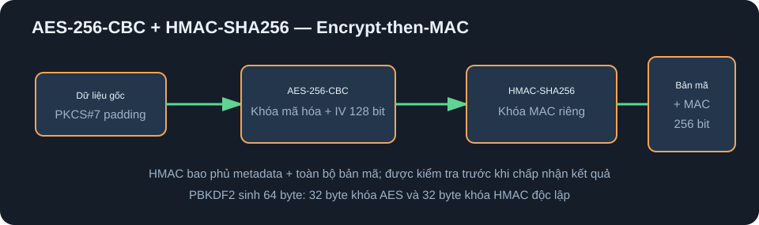

# FileCryptoQt — CryptoLab

Ứng dụng desktop Qt 6/C++ dùng OpenSSL để mã hóa và giải mã văn bản, hình ảnh, video, tệp nhị phân hoặc toàn bộ thư mục. Giao diện có xem trước nội dung, tiến trình chạy nền và mô phỏng dữ liệu trước/sau khi truyền.

   

## Chức năng

- Mã hóa/giải mã một tệp hoặc toàn bộ thư mục theo kiểu đệ quy.
- Kéo thả tệp và thư mục trực tiếp vào cửa sổ.
- Ba lựa chọn: AES-256-GCM, ChaCha20-Poly1305 và AES-256-CBC + HMAC-SHA256.
- Đọc/ghi streaming theo khối 1 MB, phù hợp với video lớn.
- Xem văn bản, ảnh và video sau giải mã; tệp nhị phân và bản mã hiển thị HEX.
- Khôi phục tên, phần mở rộng và MIME gốc từ định dạng `FCQ2`.
- Phát hiện sai mật khẩu hoặc dữ liệu bị sửa trước khi chấp nhận kết quả.
- Hiệu ứng tiến trình, nhật ký và mô phỏng đường truyền.
- Tương thích tệp `FCQ1` từ phiên bản đầu.

## Ba thuật toán

### AES-256-GCM



AES-GCM là chế độ AEAD: một lần xử lý vừa mã hóa để giữ bí mật, vừa tạo thẻ xác thực để kiểm tra tính toàn vẹn. Ứng dụng dùng khóa AES 256 bit, nonce ngẫu nhiên 96 bit và tag 128 bit. Metadata FCQ2 được đưa vào AAD nên tên tệp, MIME hoặc thuật toán cũng không thể bị thay đổi âm thầm.

Đây là lựa chọn mặc định. Nó phù hợp với máy có tăng tốc AES và thường đạt tốc độ hàng trăm MB/s hoặc cao hơn.

### ChaCha20-Poly1305



ChaCha20 tạo keystream rồi XOR với dữ liệu; Poly1305 tạo tag xác thực cho bản mã và metadata. Ứng dụng dùng khóa 256 bit, nonce 96 bit và tag 128 bit. Chế độ này đặc biệt phù hợp với CPU không có tập lệnh tăng tốc AES và vẫn cung cấp cả bí mật lẫn toàn vẹn.

### AES-256-CBC + HMAC-SHA256



CBC mã hóa dữ liệu theo block 128 bit và dùng PKCS#7 padding. CBC tự thân không xác thực, vì vậy CryptoLab triển khai mô hình **encrypt-then-MAC**: mã hóa trước, sau đó HMAC-SHA256 bao phủ metadata và toàn bộ bản mã. PBKDF2 sinh 64 byte vật liệu khóa, chia thành khóa AES 32 byte và khóa HMAC 32 byte độc lập. HMAC được kiểm tra trước khi tệp kết quả được commit.

Chế độ này hữu ích khi cần CBC vì lý do tương thích. Với ứng dụng mới, ưu tiên AES-GCM hoặc ChaCha20-Poly1305.

## Dẫn xuất khóa và định dạng FCQ2

Mật khẩu không được dùng trực tiếp làm khóa. PBKDF2-HMAC-SHA256 chạy 200.000 vòng với salt ngẫu nhiên 16 byte. Mỗi lần mã hóa tạo salt và nonce/IV mới nên hai lần mã hóa cùng một tệp bằng cùng mật khẩu vẫn tạo bản mã khác nhau.

```text
FCQ2 header
├── magic + phiên bản
├── mã thuật toán
├── salt
├── nonce/IV
├── tên tệp gốc
├── MIME gốc
├── ciphertext toàn bộ tệp
└── AEAD tag hoặc HMAC-SHA256
```

Toàn bộ tệp được xử lý. Giới hạn 8 KB chỉ dành cho vùng xem trước HEX nhằm giữ giao diện phản hồi nhanh.

## Xử lý thư mục

Nhấn **Thư mục** hoặc kéo một thư mục vào cửa sổ:

- Khi mã hóa, mọi tệp con được ghi sang thư mục kết quả và nhận thêm đuôi `.fcq`.
- Khi giải mã, ứng dụng chỉ đọc tệp `.fcq` và khôi phục tên gốc.
- Thanh tiến trình biểu diễn toàn bộ lô tệp.

## Kiến trúc

```text
MainWindow (UI)
├── QtConcurrent worker
│   └── CryptoEngine
│       ├── PBKDF2 / random salt / nonce
│       ├── OpenSSL EVP streaming
│       └── FCQ1 + FCQ2 parser
├── FilePreview
│   ├── text
│   ├── image
│   ├── video/audio
│   └── binary/HEX
└── TransmissionWidget
    └── mô phỏng nguồn → thuật toán → dữ liệu truyền
```

## Nhánh theo hệ điều hành

| Nhánh | Mục tiêu | Đóng gói |
|---|---|---|
| [`master`](https://github.com/soncris3012/FileCryptoQt/tree/master) | Mã nguồn tương thích macOS, Windows và Linux | CMake/CPack chung |
| [`macos`](https://github.com/soncris3012/FileCryptoQt/tree/macos) | Apple Silicon/Intel, app bundle | `macdeployqt`, DMG |
| [`windows`](https://github.com/soncris3012/FileCryptoQt/tree/windows) | Windows 10/11 x64 | `windeployqt`, ZIP |
| [`linux`](https://github.com/soncris3012/FileCryptoQt/tree/linux) | Linux x86_64 | AppDir, AppImage khi có `linuxdeploy` |

## Build chung

Yêu cầu CMake 3.21+, trình biên dịch C++17, Qt 6 với Widgets/Multimedia/Concurrent và OpenSSL.

```bash
cmake -S . -B build -DCMAKE_BUILD_TYPE=Release
cmake --build build --config Release -j
```

Mở `CMakeLists.txt` bằng Qt Creator để build hoặc mở `mainwindow.ui` bằng Qt Designer để chỉnh giao diện kéo thả.

### macOS

```bash
brew install qt openssl@3 cmake
cmake -S . -B build -DCMAKE_PREFIX_PATH="$(brew --prefix qt)" -DOPENSSL_ROOT_DIR="$(brew --prefix openssl@3)"
cmake --build build -j
open build/FileCryptoQt.app
```

### Windows

Cài Qt 6 MSVC, Visual Studio 2022, CMake và OpenSSL x64:

```powershell
cmake -S . -B build -G "Visual Studio 17 2022" -A x64 -DCMAKE_PREFIX_PATH="C:\Qt\6.8.0\msvc2022_64"
cmake --build build --config Release
```

### Linux

Ví dụ Ubuntu/Debian:

```bash
sudo apt install build-essential cmake qt6-base-dev qt6-multimedia-dev libssl-dev
cmake -S . -B build -DCMAKE_BUILD_TYPE=Release
cmake --build build -j
./build/FileCryptoQt
```

## Kiểm thử đã thực hiện

- Round-trip dữ liệu nhị phân lớn hơn 3 MB với cả ba thuật toán.
- So sánh từng byte sau giải mã.
- Sửa một byte trong bản mã và xác nhận cả ba chế độ từ chối.
- Mã hóa/giải mã thư mục nhiều cấp và so sánh các tệp khôi phục.

Đây là dự án học tập/nghiên cứu đã sử dụng primitive chuẩn qua OpenSSL EVP, chưa thay thế kiểm toán bảo mật độc lập cho hệ thống sản xuất có yêu cầu chứng nhận.
